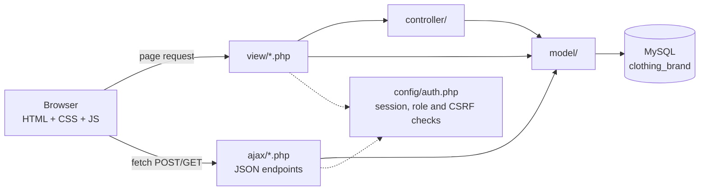
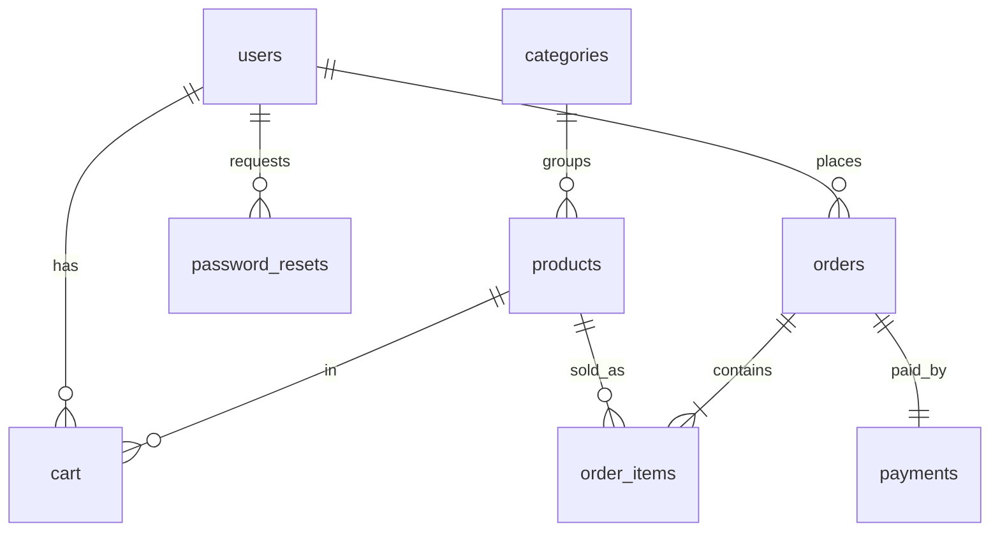

# DeshiDrip Clothing

An online clothing store for Bangladeshi fashion, built with plain PHP, MySQL and AJAX in an MVC folder structure. Customers browse, search, pick a size and place orders. Admins manage products, customers and order approvals.


**Live demo:** https://deshidrip.infinityfreeapp.com

## Features

**Visitor**
- Home page with featured products and new arrivals
- Live product search with gender and category filters (AJAX, no page reload)
- Product page with size chart and size picker
- Register, login, remember-me, and forgot-password with a one-time reset link

**Customer**
- Cart with add, update quantity and remove, all through AJAX
- Checkout with payment method and transaction ID (simulated, no real gateway)
- Purchase history and cancellation of pending orders
- Profile with picture upload and password change

**Admin**
- Dashboard with product, customer, order and pending-order counts
- Add, edit and delete products with image upload
- Customer list and full order history
- Confirm or reject orders; stock is returned when an order is rejected or cancelled

## Tech stack

| Layer | Used |
|---|---|
| Backend | PHP 8, `mysqli` |
| Database | MySQL / MariaDB |
| Frontend | HTML5, CSS3, JavaScript (`fetch`) |
| Pattern | MVC folders plus JSON endpoints in `ajax/` |
| Local server | XAMPP (Apache + MySQL) |

## Architecture



## Database



Tables: `users`, `categories`, `products`, `cart`, `orders`, `order_items`, `payments`, `password_resets`.

## Security

- Passwords hashed with `password_hash` (bcrypt)
- CSRF token on every form and every AJAX request
- Role checks for admin and customer on pages and endpoints
- Session and remember-me cookies are `HttpOnly` and `SameSite=Lax`; session ID regenerated on login
- Uploads accept only real JPEG or PNG (checked by file content) and are saved with a fixed extension
- Public registration always creates a customer; admins are created in the database
- Checkout runs as one database transaction and cannot sell more stock than exists

## Run it locally (XAMPP)

1. Install [XAMPP](https://www.apachefriends.org) and start **Apache** and **MySQL**.
2. Copy this folder into `C:\xampp\htdocs\` (for example as `deshi`).
3. Open `http://localhost/phpmyadmin`, choose **Import**, and import `database/clothing_brand.sql`. It creates the `clothing_brand` database with sample categories, products and two demo accounts.
4. Open `http://localhost/deshi/view/home.php`. If your Apache uses port 8080, use `http://localhost:8080/deshi/view/home.php`.

The default database login in `config/db.php` is user `root` with an empty password (the XAMPP default).

### Demo accounts

| Role | Email | Password |
|---|---|---|
| Admin | `admin@gmail.com` | `12345678` |
| Customer | `customer@gmail.com` | `12345678` |

Change these passwords on any public deployment.

## Deploy on free PHP hosting

1. Create a MySQL database in the host's control panel.
2. Import `database/clothing_brand_hosting.sql` in phpMyAdmin (it has no `CREATE DATABASE` line).
3. Copy `config/db.local.example.php` to `config/db.local.php` and fill in the host, user, password and database name. This file is git-ignored.
4. Upload the project files into the site's `htdocs` folder.

Password reset links are shown on screen for customer accounts while `$resetDemoMode = true` (the default), because free hosts rarely send email. Set it to `false` once the host can send mail.

## Project structure

```
ajax/         JSON endpoints: cart, checkout, search, cancel order, order status
config/       db.php (connection), auth.php (sessions, roles, CSRF)
controller/   AuthController, ProductController
model/        User, Product, Cart, Order, PasswordReset (all SQL lives here)
view/         Pages: home, products, cart, checkout, profile, admin_*, login, ...
public/       css/style.css, img/logo.svg, uploads/
database/     clothing_brand.sql, clothing_brand_hosting.sql
```

## Known limitations

- Payments are recorded but not processed; no real payment gateway is connected.
- Queries use escaped strings, not prepared statements.
- No login rate limiting.
- Password-reset email depends on the host's mail setup.

## Possible next steps

- Prepared statements (`mysqli_prepare`) for all queries
- Rate limiting on login and password reset
- Real payment integration (bKash or Nagad sandbox)
- Order email notifications and product reviews
